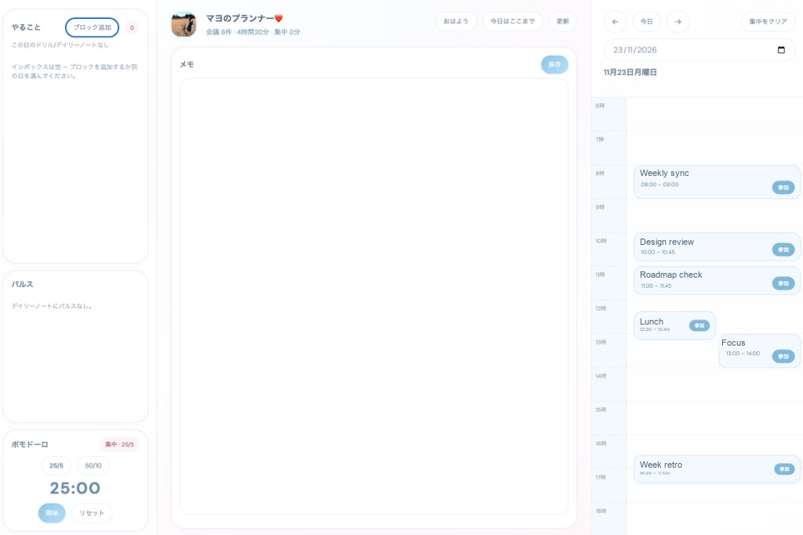

# Day planner

Single-day timeline: tasks, notes, pomodoro, and a calendar strip. Runs locally. No account required.


## Run

```bash
cd day-planner
chmod +x serve.sh
./serve.sh
```

Open [http://127.0.0.1:2222](http://127.0.0.1:2222).

## Layout

| Zone | Content |
|---|---|
| Left | Todo, a short pulse list, pomodoro |
| Centre | Notes. Save writes a timestamped file under `vault/00-inbox/` |
| Right | One day, 6:00–19:00, 15-minute snap |

Meeting time and focus time are counted separately. Meetings come from the calendar cache. Focus time is the blocks you drag onto the timeline.

## Calendar

Meetings load from `.calendar-cache.json` (times shown in Asia/Hong_Kong).

1. Copy `calendar-export.example.json` to `calendar-export.json` and replace the sample event.
2. Restart, or press **Refresh**. That runs `refresh_calendar.py`.
3. Or POST `{ "documents": [ ... ] }` to `/api/calendar/import`.

Each document needs `title`, `eventStartTime`, `eventEndTime` (`YYYY-MM-DDTHH:MM:SS`, UTC), and a join link in `snippets`, `location`, or `url`.

## Notes vault

Optional, and local to this folder:

| Path | Use |
|---|---|
| `vault/00-inbox/` | Saved notes |
| `vault/01-daily/YYYY/MM/YYYY-MM-DD.md` | Daily note. Unchecked items under `### Today's order` and `## ✅ Tasks` show in the todo list |
| `vault/07-research/japanese/drills/YYYY-MM-DD.md` | Optional drill checklist |

Focus blocks are stored in `data/blocks/YYYY-MM-DD.json` and in the browser. **Clear focus blocks** removes your blocks only.

## Optional scripts

**おはよう** runs `bin/morning.sh` if you add one. **今日はここまで** runs `bin/end-of-day.sh` if you add one. Neither ships in this folder.
